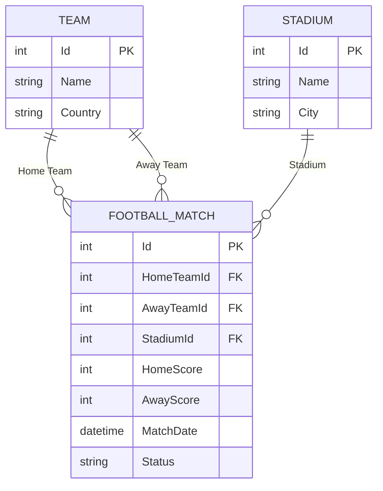

# FootballMatches

## Тема

Облік футбольних матчів.

## Основний тип предметної області

Основним типом предметної області є `FootballMatch`.

Властивості типу:

- `Id` — ідентифікатор матчу;
- `HomeTeam` — команда господарів;
- `AwayTeam` — команда гостей;
- `HomeScore` — кількість голів команди господарів;
- `AwayScore` — кількість голів команди гостей;
- `MatchDate` — дата проведення матчу;
- `Stadium` — стадіон, на якому проводиться матч;
- `Status` — статус матчу.

## Особливість проєкту

Особливістю проєкту буде можливість переглядати статистику результатів матчів за певний період. Користувач зможе аналізувати кількість зіграних матчів та забитих голів за вибраний період, що спростить перегляд історії футбольних матчів.

# FootballMatches

## Лабораторна робота №7 — Зв'язки між сутностями та довідники

### Опис проєкту

FootballMatches — вебзастосунок для обліку футбольних матчів, розроблений із використанням Blazor, C#, Entity Framework Core та SQLite.

У лабораторній роботі №7 реалізовано зв'язки між футбольними матчами, командами та стадіонами.

Додано Competition, тобто чемпіонат або ліга, де проводиться матч. 
- `Competition` — чемпіонат або ліга, де проводиться матч;

### Використані технології

- C# / .NET 10
- ASP.NET Core Blazor
- Entity Framework Core
- SQLite
- QuickGrid
- Visual Studio Code
- Git / GitHub

### Основні сутності

**FootballMatch**

Основна сутність, що містить інформацію про футбольний матч: команди, рахунок, дату, стадіон та статус.

**Team**

Довідник футбольних команд, який містить назву команди та країну.

**Stadium**

Довідник футбольних стадіонів, який містить назву стадіону та місто.

### Зв'язки між сутностями

- FootballMatch.HomeTeamId → Team.Id
- FootballMatch.AwayTeamId → Team.Id
- FootballMatch.StadiumId → Stadium.Id

Усі три зв'язки мають тип «один до багатьох».

### Mermaid-діаграма сутностей



### Реалізований функціонал

1. Створення та редагування футбольних команд.
2. Перегляд і видалення команд.
3. Створення та редагування стадіонів.
4. Перегляд і видалення стадіонів.
5. Вибір домашньої та гостьової команд у формі матчу.
6. Вибір стадіону у формі матчу.
7. Збереження зовнішніх ключів у базі даних.
8. Відображення назв пов'язаних сутностей.
9. Перевірка правильності вибору команд.
10. Захист пов'язаних записів від випадкового видалення.

### Робота з базою даних

Для зберігання даних використовується SQLite.

Зміни структури бази даних виконуються через міграції Entity Framework Core.

Команда застосування міграцій:

```bash
dotnet ef database update
```

### Результат

У лабораторній роботі №7 створено пов'язані довідники Team і Stadium, налаштовано зв'язки з FootballMatch та реалізовано роботу із зовнішніми ключами.

Завдяки цьому футбольні матчі можна створювати та редагувати, вибираючи команди й стадіони зі списків, без повторного введення їхніх назв.